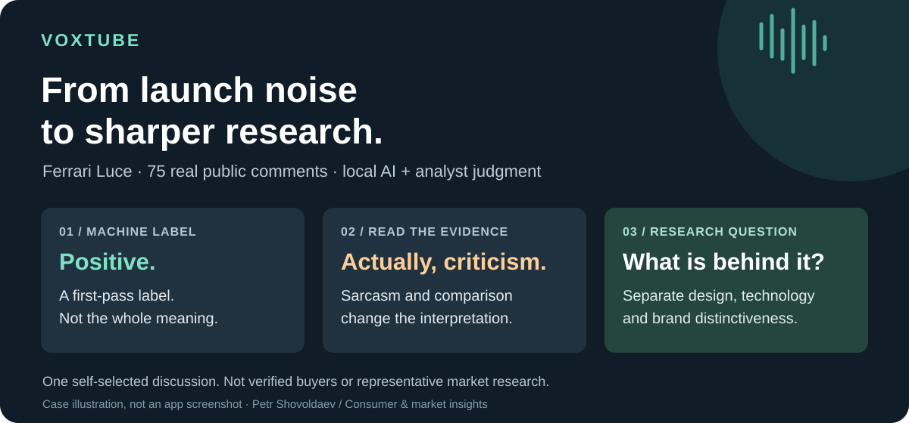

  

# VoxTube · Listening is easy. Understanding takes judgment.

**I built a local-AI research tool to turn public product discussion into questions a marketing team can act on. Then I tested where its answers could mislead us.**

**[Read the real Ferrari Luce case →](REAL_ANALYSIS.md)** · [See the interface](#see-the-tool) · **[Meet me on LinkedIn →](https://www.linkedin.com/in/pshovoldaev/)**

*Petr Shovoldaev · Consumer & market insights · Independent personal project*

## The case in 30 seconds

A launch generates plenty of reaction. A team still needs to decide what deserves
attention: the design, the technology, the brand—or simply a joke that a model
took literally.

I used **75 real comments from a Ferrari Luce discussion on Hacker News** to test
that path. The first classifier labelled some critical, sarcastic wording as
positive. A second local model recognised criticism in two selected examples,
but missed the possible meaning of a competitor comparison in a third.

**My conclusion wasn't “use a smarter model.” It was “make the evidence easy to inspect—and keep the analyst in the loop.”**

That changes the next step: investigate exterior appeal, technology and brand
distinctiveness separately, rather than turn an overall sentiment score into
advice to the launch team.

One self-selected discussion, not verified buyers. Three deliberately selected review cases, not an accuracy benchmark. Comments dated May 2026; analysed in October 2026. [Method and limits](REAL_ANALYSIS.md#method-and-limits).

## What I built—and the choices behind it

| The problem | My response |
| --- | --- |
| Useful reactions are buried in unstructured discussion | Build a collection and classification workflow with source-linked evidence |
| A score hides what people actually mean | Keep comments, filters and an optional local-AI second reading close together |
| An interesting observation gets lost after the meeting | Save evidence notes with their analytical context and export the current view |
| Repeating a search can create a misleading “trend” | Save study settings and flag method differences between aggregate snapshots |
| An exploratory tool still has practical constraints | Make collection limits explicit and keep AI inference local in this case |

I framed the research problem, designed the workflow and used AI coding tools to
help implement it. I tested the result against real discussion, challenged the
outputs and kept the limits visible. The aim was not to automate judgment away;
it was to build something that helps me exercise it more effectively.

## Where a team could use it

- **Marketing:** identify reactions worth probing before changing a launch message.
- **Consumer research:** turn recurring concerns into interview prompts or survey hypotheses.
- **Competitive intelligence:** distinguish a rival mention from genuine consideration or a passing comparison.

The value is a shorter, inspectable path from scattered discussion to a research
brief—not proof of customer demand or a replacement for representative research.
Time savings and commercial impact have not been measured.

## See the tool

**[Watch the 60-second interface walkthrough →](videos/voxtube-walkthrough.mp4)** · [Text walkthrough](WALKTHROUGH.md)

The screenshot and video show the working prototype with **synthetic Orion E5
data**, not the Ferrari sample. The video is a captioned still-screen walkthrough,
not a live AI recording. On GitHub's video page, select **View raw** or download
to play it. The **[real-analysis case](REAL_ANALYSIS.md)** documents the separate
Ferrari run and model disagreement; a live case-study video is not included yet.

More interface views: overview and repeat-study comparison

These screens demonstrate capabilities, not real market findings or change over time.

## Instruments, not a black box

**Python · pandas · Streamlit · Hugging Face Transformers · Ollama · Plotly**

In the real case, the official Hacker News API supplied the discussion; RoBERTa
assigned initial sentiment, BART assigned themes, and **Gemma4:12b-mlx** provided
a second reading locally through Ollama. Human interpretation remained separate
from model labels. [Execution details and findings](REAL_ANALYSIS.md#what-actually-ran).

The private application also has YouTube and Bluesky adapters, saved studies,
evidence notes and Excel export. This case does not establish approval for
YouTube-derived analytics or commercial deployment.

---

**I enjoy finding useful sources of evidence, learning the tools needed to work
with them, and turning an idea into something a team can examine and challenge.**

If that combination of consumer insight, practical building and analytical
judgment fits your team, **[let's talk](https://www.linkedin.com/in/pshovoldaev/)**.
You can also explore **[PlaceSignal](https://github.com/PandasAndChill/placesignal-showcase)**,
my companion location-review project.

Portfolio showcase, not a downloadable product. Application code, raw comments,
credentials and model weights remain private. No employer data is included.
The [MIT notice](LICENSE) covers the included showcase materials, not third-party
platform content or model weights.
