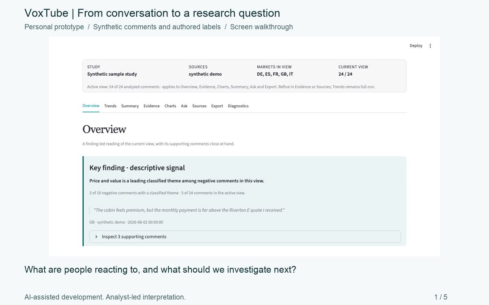
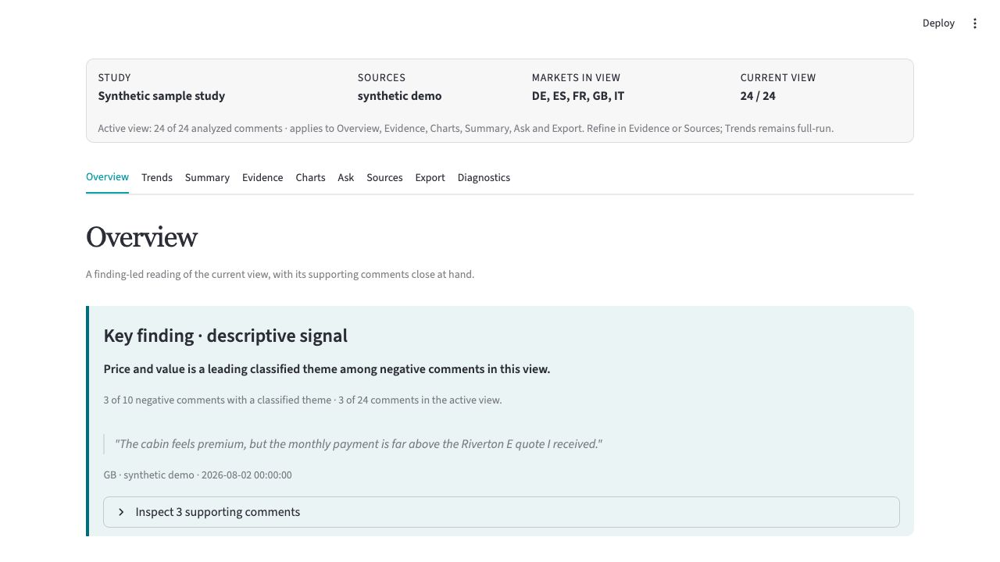
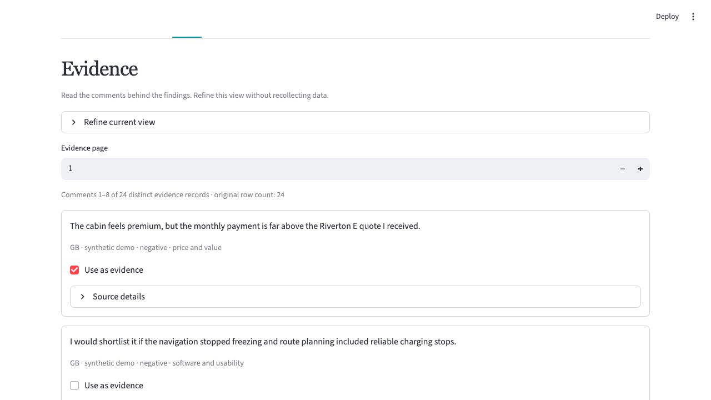
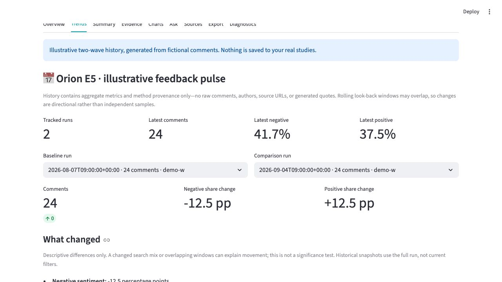

# VoxTube

**What are people reacting to—and what should we investigate next?**

VoxTube turns scattered public product discussion into a focused research workflow:
find recurring concerns, read the comments behind them, and revisit the same question over time.

I built it to explore a practical idea: public conversation can help us ask better
research questions, provided we don't mistake it for a representative survey.

*Petr Shovoldaev · Consumer & market insights · [LinkedIn](https://www.linkedin.com/in/pshovoldaev/)*

**[Watch the 60-second walkthrough](videos/voxtube-walkthrough.mp4)** · captioned, sound not required.
Actual prototype screenshots, presented as a guided screen walkthrough—not a live collection or AI-generation recording.
All comments, classifications and history shown are **synthetic**. [Text version](WALKTHROUGH.md).

## The problem I wanted to solve

A product team sees discussion under reviews and launch videos. Some comments are
specific and useful; others are off-topic, repetitive or difficult to interpret.
A sentiment score alone doesn't tell the team what to investigate.

I wanted to make the path from **“people are talking about this”** to
**“here is a question worth following up”** more structured and inspectable.
VoxTube is designed to support exploration before deeper research—not replace it.

| A research question | What the tool helps you do |
| --- | --- |
| What keeps coming up? | Explore themes, sentiment and purchase-related language, with counts and bases |
| What do people actually mean? | Read the underlying comments and select evidence for an analyst finding |
| Is “too expensive” about payment, equipment or alternatives? | Follow the wording back to a more specific question rather than stopping at a negative label |
| What changed since the last run? | Reuse a saved setup and compare aggregate snapshots, keeping method and scope differences visible |
| Can I take this into a discussion? | Export the current view and its context for further analysis |

## A short investigation

### 1. Start with a signal, not a verdict

In the fictional example, price is **one** leading negative theme. Three comments
support it; software also has three. The headline and base keep that small signal
in proportion instead of presenting a decisive market finding.

### 2. Read the evidence before deciding what it means

One comment compares monthly payments; another raises included equipment. That
distinction changes the next question. I'd investigate affordability and perceived
value separately rather than conclude that the product simply needs a price cut.

### 3. Return to the question

Saved studies make follow-up possible. These two illustrative runs demonstrate the
comparison—not a real improvement. A different search mix or overlapping time
windows can change the result without the underlying market having changed.

## The choices behind the tool

- **Start from a decision.** A topic, research question, scope and collection budget
  come before analysis. The aim is a useful investigation, not the largest dataset.
- **Keep evidence close.** Counts and summaries should lead back to comments the
  analyst can inspect, not require trust in a black-box answer.
- **Make comparisons honest.** Preserve the study setup and method context; don't
  quietly treat incompatible runs as comparable.
- **Use AI as assistance.** Classification and narrative generation can help with
  exploration, but errors remain possible. Interpretation stays with the analyst.
- **Design for practical constraints.** Local processing by default, API-quota
  estimates, reusable settings and exports are part of the workflow—not afterthoughts.

I used AI coding tools to help learn and implement the application. Framing the
problem, choosing the workflow, testing the result and deciding what it was safe
to claim remained my responsibility. The project is an example of taking an idea
outside my existing toolkit and turning it into something I can demonstrate and challenge.

## Instruments used

| Instrument | Its role |
| --- | --- |
| Python, pandas and Streamlit | Data preparation and an interactive research interface |
| YouTube Data API; Bluesky and Hacker News adapters | Public-discussion collection in the private prototype |
| Hugging Face Transformers | Local translation and text classification |
| Ollama with a local Gemma model | Optional summaries and evidence-grounded questions |
| Plotly and Excel export | Exploration and handoff of the current analytical view |
| Automated tests and documented checks | Guardrails for scope, saved studies, exports and reproducible packaging |

This is an implementation overview. The video does not run APIs or models, and
synthetic labels are not evidence of classifier accuracy.

## What this does—and doesn't—demonstrate

The media uses 24 authored comments about an imaginary vehicle, **Orion E5**, and
an illustrative two-wave history. It shows a working interface and an analytical
approach, not real customer findings, measured time savings or validated model performance.

Public comments are self-selected. A search-market setting does not establish
where a commenter lives. Translation, classification, search ranking and source
mix can all affect the reading. A useful signal is a reason to investigate—not
an estimate of what everyone thinks.

This is a **personal prototype and portfolio showcase**. The implementation stays
private; this repository contains only selected presentation materials. It is not
a downloadable product or a hosted service. Live deployment has unresolved
platform, licensing and data-lifecycle requirements. No employer or private customer
data is included in this showcase.

## About the project

I enjoy turning messy questions into something a team can examine and act on.
VoxTube shows one approach: find a useful source of information, build the means
to explore it, then put limits around what the evidence can support.

**[Let's talk on LinkedIn](https://www.linkedin.com/in/pshovoldaev/)** ·
**[PlaceSignal: my companion location-review project](https://github.com/PandasAndChill/placesignal-showcase)**

The included showcase materials retain the [project's MIT notice](LICENSE).
Application code, model weights and platform content are not distributed here.
