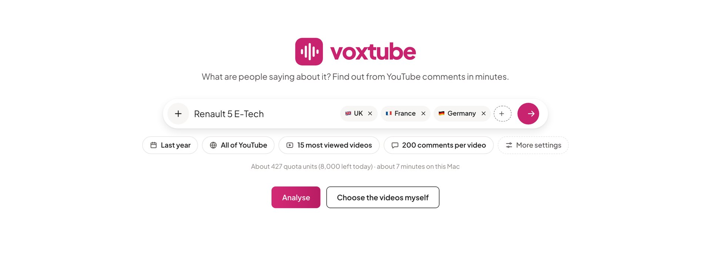
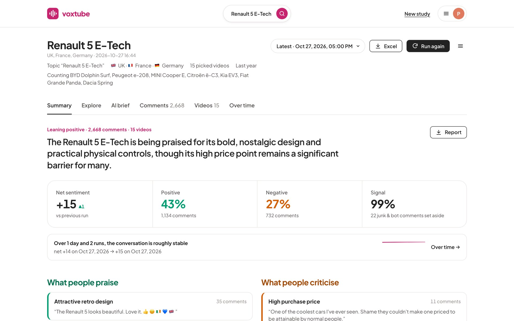
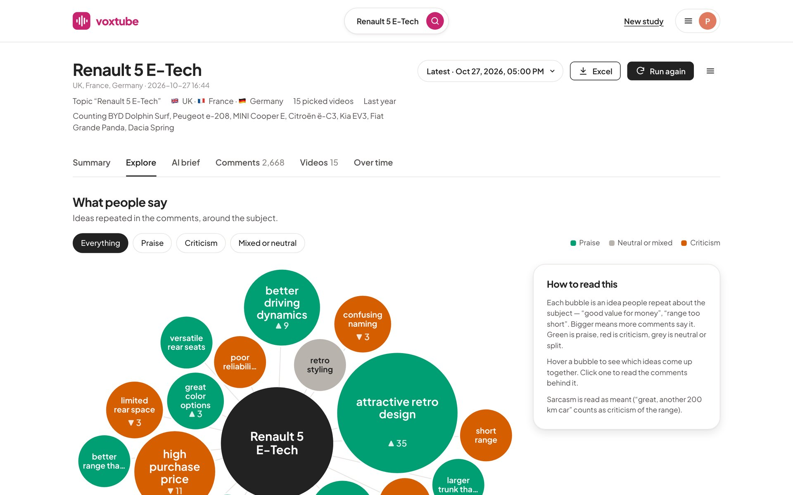
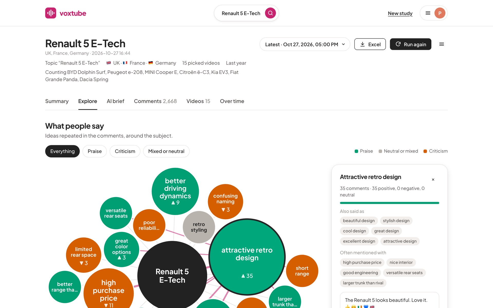
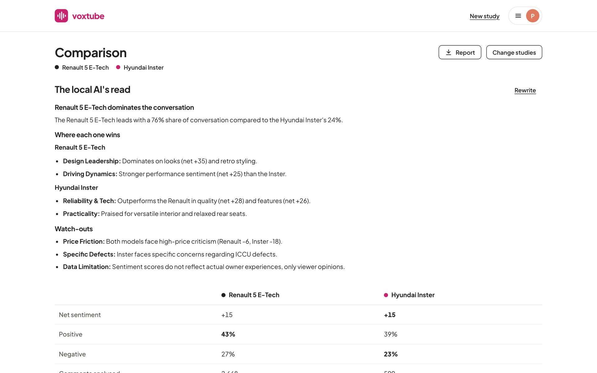
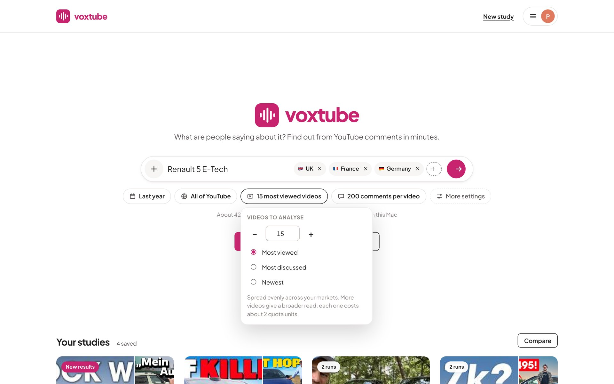
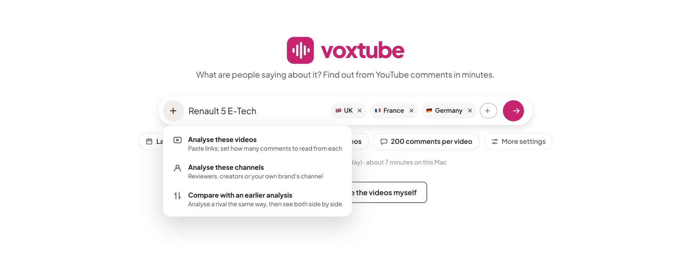
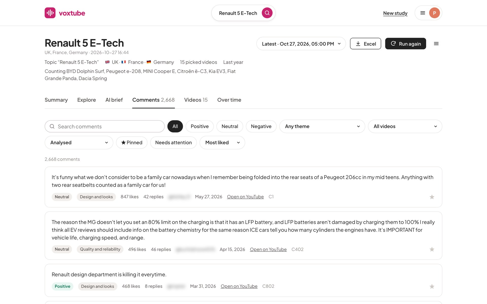

# VoxTube · What are people saying about it?

**A desktop research tool I designed and built to read a product's public reception on YouTube — across
markets and languages — and turn thousands of comments into findings a marketing team can act on.**

**[Watch the 40-second walkthrough →](videos/voxtube-walkthrough.mp4)** · **[Read the Renault 5 vs Hyundai Inster case →](CASE_STUDY.md)** · **[Meet me on LinkedIn →](https://www.linkedin.com/in/pshovoldaev/)**

*Petr Shovoldaev · Consumer & market insights · Independent personal project*

## The problem

When a product launches, the first real reaction isn't in a survey. It's in the comment sections under reviews,
in several languages, mixed with jokes, bots and spam — and it moves faster than any tracker. Reading it by hand
takes days; a single sentiment score hides what people actually mean.

## What VoxTube does

| A team needs to… | VoxTube… |
| --- | --- |
| **Find the conversation that matters** | Searches YouTube market by market (51 countries), adds the curated reviewers and press for the industry, or reads only the channels or videos you choose |
| **Separate signal from noise** | Sets aside bots, spam and junk, and says how many and why |
| **Read every language** | Analyses comments in their own language and translates the most-liked ones for reading |
| **Know what people mean, not just a score** | Groups what people repeat into ideas — "attractive retro design", "high purchase price" — coloured by how they feel, with sarcasm read as meant |
| **Trust the result** | Every figure links back to the comments behind it; the analyst can correct any label, and the figures update |
| **Act on it** | Surfaces likely buyers, upvoted complaints, unanswered questions and the features people ask for |
| **Compare** | Puts a product and its rivals side by side: share of conversation, sentiment, themes and where each one wins |
| **Follow it over time** | Saves every study; a rerun weeks or months later shows how sentiment moved |
| **Stay within limits** | Shows the cost before each run and splits big requests into daily parts that add up to one result |

Everything after the download runs **on a laptop**: the analysis and the AI summaries are local, so no comment
data is sent to a cloud AI service.

## See it

**The summary an executive reads first** — one headline, four numbers, what people praise and criticise, each with
a real quote.

**What people say, at a glance** — each bubble is an idea people repeat; size is how many said it, green is
praise, orange criticism.

**The evidence behind every idea** — click a bubble to read the comments behind it.

**Rivals side by side** — with a short, figure-grounded read written by the local AI.

More screens: scope controls, other ways to start, the comment reader

## How I approached it

- **Start from the decision, not the data.** The first screen answers "how is it landing, and why?"; detail is one
  click away for whoever needs it.
- **Keep the analyst in the loop.** Models misread sarcasm and comparisons, so every number is traceable to
  comments, and corrections are kept and re-applied on reruns.
- **Be honest about the sample.** Commenters choose to comment; VoxTube is a fast read of the public conversation
  and a source of hypotheses — not a representative survey. The app says so.
- **Design for real constraints.** YouTube's free quota, a laptop's memory, a local AI that can stop answering: the
  tool plans around all three and tells the user what happened.

I framed the research problem, designed the product and its workflow, and built it with AI coding tools as my
pair. I tested it on real launches, challenged its outputs and fixed what misled.

## Where a team could use it

- **Launch tracking:** first reaction by market in the week of a launch, then a rerun a month later.
- **Competitive intelligence:** a rival's launch read the same way as your own, side by side.
- **Consumer research:** recurring concerns and requests turned into interview guides or survey hypotheses.
- **Community and social teams:** unanswered questions and upvoted complaints worth a reply.

---

**I enjoy finding useful sources of evidence, learning the tools needed to work with them, and turning an idea into
something a team can examine and challenge.** If that combination of consumer insight, practical building and
analytical judgment fits your team, **[let's talk](https://www.linkedin.com/in/pshovoldaev/)**. You can also
explore **[PlaceSignal](https://github.com/PandasAndChill/placesignal-showcase)**, my companion location-review
project.

Portfolio showcase, not a downloadable product. The application code, collected comments, credentials and
models remain private. No employer data is included. Comments shown are public YouTube comments, with commenter
names blurred. The [MIT notice](LICENSE) covers the showcase materials, not third-party content.
